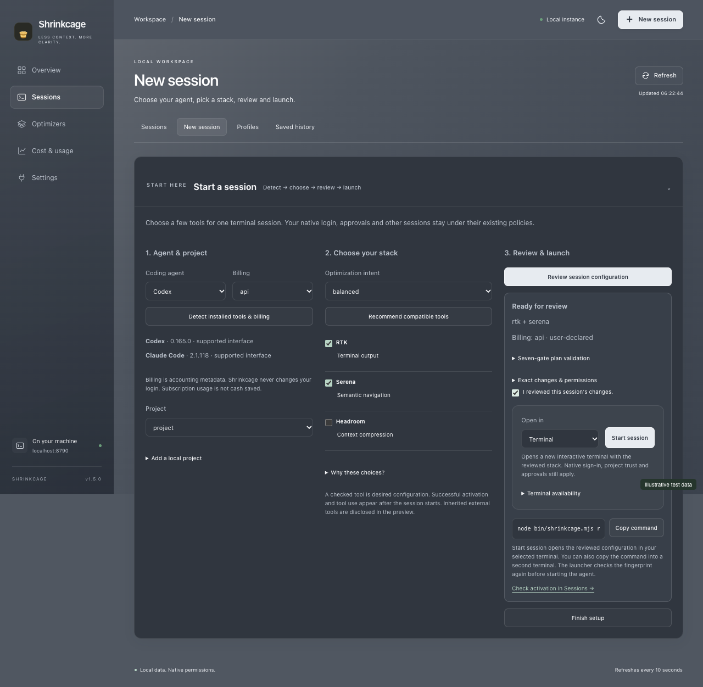

<p align="center"></p>

# Shrinkcage

**Local-first token and cost optimization for AI coding sessions.**

Choose a stack for each Codex or Claude Code session. See what actually ran, understand usage and compare results without guessing at savings.

[](https://github.com/datasound-projects/Shrinkcage/actions/workflows/ci.yml)

[Download ZIP](https://github.com/datasound-projects/Shrinkcage/archive/refs/heads/main.zip) · [Setup help](docs/SETUP.md) · [Supported tools](docs/COMPATIBILITY.md) · [Report a problem](https://github.com/datasound-projects/Shrinkcage/issues)

## Download, install and open

1. Install [Node.js 22.13 or newer](https://nodejs.org/en/download), including npm.
2. [Download Shrinkcage](https://github.com/datasound-projects/Shrinkcage/archive/refs/heads/main.zip) and extract it.
3. Open a terminal in that folder and run:

   ```sh
   node scripts/start.mjs
   ```

This installs dependencies, builds the app and opens **[localhost:8790](http://localhost:8790)**. Keep the terminal open; press **Ctrl+C** to stop. macOS/Linux users can run `./start.sh`; Windows users can use `start.cmd` or `.\start.ps1`.

No Docker, cloud service or Shrinkcage account is needed. Install and sign in to your coding CLI separately. Optional tools can be absent.


## Start your first session

In **Sessions**, click **Start session**. Select Codex or Claude Code, choose billing and a project, then pick compatible tools. Review the plan, select **Terminal** or **Herdr**, and click **Start session**. The native CLI opens with that exact stack. Copy command is available as a fallback. No manual JSON editing is needed.

Herdr 0.9.5+ launches are supported on macOS/Linux through a separate private session. Normal terminals also support Windows PowerShell. Native sign-in, project trust and approvals still apply. [Terminal support and safeguards →](docs/TERMINALS.md)

- **Overview:** recent sessions and separate optimizer contributions.
- **Sessions:** independent stacks, actual activation, tool activity and saved history.
- **Optimizers:** a reviewed registry, local installations and validation details.
- **Cost & usage:** reported tokens, qualified price estimates and controlled comparisons.
- **Settings:** local discovery, billing, prices, privacy and diagnostics.

One screen is shown at a time. Context tabs hold secondary tools; drafts survive navigation. Choose silver or graphite appearance. Existing deep links still work, even when a metrics source is offline.



## Launch from your terminal

From the Shrinkcage folder:

```sh
# Codex with a ChatGPT subscription
node bin/shrinkcage.mjs run codex --billing subscription --profile balanced --project "/path/to/project"

# Claude Code with API billing
node bin/shrinkcage.mjs run claude --billing api --profile lean --project "/path/to/project"
```

Replace the path with your project folder, for example `C:\Projects\my-app` on Windows. Review the plan and enter its first eight fingerprint characters when prompted. The CLI opens in that terminal. **A billing label does not change your login.** Codex API billing and Claude subscriptions are also supported.

Each launch has its own ID, tools and configuration, including concurrent sessions in the same project. Stack edits prepare the next launch; they do not reconfigure a running agent. Existing external hooks can limit isolation, and the plan explains that limitation. Native sandbox, trust and approval rules remain in place.

For a global `shrinkcage` command, run `npm run package`, then `npm install -g ./release/shrinkcage-monitor-1.5.0.tgz`. ZIP users can keep using `node bin/shrinkcage.mjs`. [Full CLI reference →](docs/SETUP.md)

## What works

| Integration | Support |
|---|---|
| Codex CLI | Managed sessions, native usage and subscription/API billing awareness |
| Modern Claude Code | Managed sessions, native usage and subscription/API billing awareness; version 2.1+ and required interfaces are checked |
| RTK | Session-scoped output-rewrite hooks; shared output-token estimates |
| Serena | Session-owned MCP with observed calls; shared dashboard monitoring |
| Headroom | Codex API routing through an existing verified proxy; shared compression metrics |
| SDK v2 MCP plugins | Approved local stdio servers, typed settings, protocol checks and owned removal |
| Gemini CLI | Read-only saved-session discovery and usage |
| Other registry tools | Scoped catalog review and guidance; automatic activation requires a reviewed adapter |

**Installed, configured and observed are different states.** The registry ships offline with ten reviewed entries. Other discoveries stay in a review queue; Token Savior remains under review. Unknown interfaces stay **Integration required**. Nothing downloads and runs repository code or silently updates executables. [Registry guide](docs/REGISTRY.md) · [Plugin SDK](docs/PLUGINS.md)

## Read the numbers correctly

Headroom and RTK savings can overlap and are never added together. Serena activity is not converted into fictional savings. Missing measurements stay N/A.

Configure exact-model prices in Settings to see estimates. API spending and subscription API-equivalent value remain separate; fewer subscription tokens do not automatically mean money saved. Summaries and budget alerts count a repeated native usage scope once. Conflicting billing declarations withhold monetary attribution, and stale/overlapping usage cannot qualify a before/after experiment. [Accounting details →](docs/ACCOUNTING.md)

## Privacy, testing and help

Shrinkcage stores allowlisted metadata, not prompts, source code, tool arguments/results or OAuth credentials. Authentication stays with the native CLI. Approved local programs retain OS permissions; a private validation workspace is not an OS sandbox.

Tests cover supported agent/billing/tool combinations, real isolated subprocess launches, accounting, cleanup, failure recovery and browser workflows. CI runs macOS, Windows and Linux with Node 22/24. Native interface and MCP checks are distinct from authenticated model-backed quality/savings tests; universal compatibility or perfect optimization is not claimed. Screenshots use labeled test data. [Executed checks and limits →](docs/VALIDATION.md)

[Setup & troubleshooting](docs/SETUP.md) · [Architecture](docs/CONTROL_PLANE.md) · [Privacy](docs/PRIVACY.md) · [Security](SECURITY.md) · [Contributing](CONTRIBUTING.md) · [MIT license](LICENSE)
