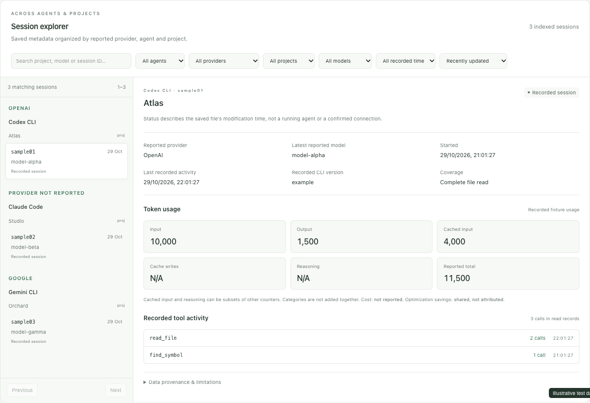

<p align="center"></p>

# Shrinkcage

[GitHub](https://github.com/datasound-projects/Shrinkcage) · [Report an issue](https://github.com/datasound-projects/Shrinkcage/issues)

Clone with `git clone https://github.com/datasound-projects/Shrinkcage.git`, then run the startup script from the `Shrinkcage` folder.

**A private, local view of your coding agents, sessions and optimization tools.**

Shrinkcage brings Codex CLI, Claude Code and Gemini CLI session metadata together with Headroom, RTK and Serena. It runs as one lightweight Node.js server at **http://localhost:8790**, with a responsive React dashboard, light/dark themes and no account, cloud service, container or telemetry requirement.


The screenshots are generated by automated UI tests using synthetic data. Production collectors always read real local sources; they contain no demo fallback.

## Install and run

Install **Node.js 22.13 or newer** with npm first. No coding agent or optimization tool is required to start the dashboard. Missing optional sources produce independent empty/offline states.

Download the project source, open its folder in a terminal, then run:

| Platform | One-command startup |
|---|---|
| macOS / Linux | `./start.sh` |
| Windows PowerShell | `.\start.ps1` |
| Windows Command Prompt | `start.cmd` |
| Any supported platform | `node scripts/start.mjs` |

Startup installs missing locked build dependencies, builds the application, serves it on **127.0.0.1:8790** and opens the default browser. Leave the terminal running. **Ctrl+C stops the owned server.** `--no-open` or `OPEN_BROWSER=0` suppresses browser opening. If PowerShell script execution is restricted, use `node scripts/start.mjs`; no security-policy change is needed.

An existing Shrinkcage server is reused. Stop it before applying a source update so the new server code is loaded. An unrelated application or legacy Codex Monitor on port 8790 is never killed automatically.

### Install a built release package

Build a release locally with `npm run package`, or obtain the `.tgz` and matching `SHA256SUMS` from a maintainer-prepared release. Review the checksum before installation.

```sh
npm install --global ./shrinkcage-monitor-1.0.0.tgz
shrinkcage
```

The built package contains the frontend, compiled backend and launcher. It requires Node but **no runtime npm dependencies**, build tools or API keys. `shrinkcage --help`, `shrinkcage --version` and `shrinkcage --no-open` are supported. Registry publication is intentionally guarded by `private: true`; local archive installation works without a registry account. Nothing in this project automatically publishes a repository or release.

## What you can see

- **Connector center:** installation on PATH, process-name observation, session-folder access, indexed history, last successful discovery, capabilities and limitations. Approve a different local session folder or disable a connector inside the app. These settings affect Shrinkcage only.
- **Session explorer:** a provider → agent → project sidebar, metadata search, project/model/provider/agent filters, time ranges, sorting and pagination. Inspect source-reported usage, recorded tool names and cumulative token history when available.
- **Headroom:** reported proxy-runtime, display-session and persisted-lifetime counters; compression and cost estimates; cache statistics; daily/weekly/monthly history.
- **RTK:** global output token estimates, reductions, command families, recent history and source calendar rollups. Read-only SQLite supplies command details when the CLI JSON export omits them.
- **Serena:** dashboard discovery, per-instance tools and activity, observed counters and a bounded activity log. A reachable dashboard is never presented as proof of a Codex MCP handshake.



Agent, model provider and model are separate fields. Unknown routing stays **Provider not reported**. File modification within two minutes is labeled **File updated recently**, not “agent running.” Process-name observation cannot reliably identify Node-wrapped CLIs or bind a process to a saved session. No agent is launched, authenticated, resumed, stopped or reconfigured by discovery.

## Data integrity

**Headroom and RTK savings can overlap and are never added together.** Optimization metrics are shared unless reliable session correlation exists; this release does not claim per-session optimization savings. Costs are not invented from model names or public price tables.

Missing or invalid fields remain N/A. Explicit reported zero is preserved. Codex uses the latest reported cumulative session counter, not a sum of cumulative checkpoints. Claude assistant usage is deduplicated by message ID. Gemini message usage follows saved JSON/JSONL records, including supported rewind/removal records. Uncertain sampled rewrites withhold totals.

Large JSONL files use a bounded metadata-head/recent-tail sample. The session view labels sampled coverage; tool counts and message-based usage then describe sampled records. Reported cumulative Codex counters retain their source scope. Cached input/reasoning categories may overlap other counters and are not added together. Exact session billing is not inferred.

Serena's log records **observation times** from counter changes, not exact call execution order. First observations show existing counts; subsequent increases group calls within a refresh. Only names and counts are retained, never arguments or results.

## Configuration and privacy

Default session locations:

| Agent | Locations |
|---|---|
| Codex CLI | `~/.codex/sessions` and `~/.codex/archived_sessions`; respects `CODEX_HOME` |
| Claude Code | `~/.claude/projects`; respects `CLAUDE_CONFIG_DIR` |
| Gemini CLI | `~/.gemini/tmp`, matching `session-*.json` and `session-*.jsonl` |

Use **Connector center → Configure discovery location** to approve an absolute, existing local session folder. Empty means the standard locations. Approval is required before saving. Network shares, whole home directories, filesystem roots and common credential folders are rejected. Symlinks are not followed during discovery. Only recognized session filenames and allowlisted metadata are processed.

Shrinkcage settings live outside the repository:

| Platform | App data |
|---|---|
| macOS | `~/Library/Application Support/Shrinkcage` |
| Windows | `%APPDATA%\Shrinkcage` |
| Linux | `${XDG_CONFIG_HOME:-~/.config}/shrinkcage` |

`SHRINKCAGE_DATA_DIR` overrides the app-data directory. Existing Shrinkage app-data folders and `SHRINKAGE_DATA_DIR` remain supported for upgrades; no agent settings are migrated or changed. `settings.json` stores only approved roots and enabled flags. Atomic writes use restrictive POSIX modes. Shrinkcage never edits the agents' own settings or authentication files. The connector write endpoint requires an exact local Origin, bounded JSON, an explicit approval flag and a per-process request capability.

Other optional environment settings are documented in [.env.example](.env.example). They must be set in your shell; the example file is not automatically sourced. `SERENA_PORT_START` / `SERENA_PORT_COUNT` default to 24282–24291, capped at 20 ports. `RTK_DATABASE_PATH` overrides RTK's history database location. No environment dump or credential is returned to the browser.

Session discovery is bounded to 2,000 directories / candidate files and the newest 500 files per connector, with a 32 MiB changed-file budget per scan. Unchanged files use a metadata-only cache; additional changed files can be indexed on subsequent refreshes. JSON files over 8 MiB are rejected with a diagnostic. Session filters apply to the current index and return at most 100 records per request. Limits are visible instead of silently implying complete history.

Optimization refresh is every 10 seconds; agent discovery is every 15 seconds. Hidden tabs pause polling. Concurrent collections are coalesced. Session metadata stays in memory, not a new transcript database. Optional `MONITOR_SNAPSHOTS=1` writes only bounded numeric optimization/Serena observations under the app-data `snapshots` directory. It does not persist session contents or the activity journal. See [Privacy](docs/PRIVACY.md) for retention and cleanup.

## Troubleshooting

- **CLI not found:** launch from a terminal whose PATH contains it. History can still be read without an installed executable. Shrinkcage does not install optional agents.
- **No saved sessions:** this is different from an installation or authentication failure. Use the CLI normally, confirm that it saves history, or approve an existing history folder. No live connection is inferred.
- **Unsupported or inaccessible files:** inspect the connector diagnostic and coverage notes. Formats can change between CLI versions. Do not upload real transcripts to public bug reports.
- **Headroom offline:** inspect `http://localhost:8787/health`; its native dashboard is `/dashboard`. For telemetry-dependent metrics, prefix your existing Headroom launch command with `HEADROOM_TELEMETRY=on` and restart that service yourself.
- **RTK command details unavailable:** JSON summary remains functional. Check its database location/schema or set `RTK_DATABASE_PATH`. Node 22 may emit an informational built-in SQLite experimental warning.
- **Serena idle:** empty counters show No activity. A valid count from one instance is retained even when others are idle. Check your agent's own MCP handshake, active project and startup logs; the monitor does not repair them.
- **Listener inspection unavailable:** HTTP health checks still work. macOS uses lsof, Linux uses lsof or ss, and Windows uses a fixed read-only Get-NetTCPConnection query. Permissions and platform capabilities may limit process details.
- **Port occupied:** resolve the existing owner of 8790 yourself. Shrinkcage refuses to kill unrelated processes.
- **Browser did not open:** visit http://localhost:8790. Browser-install/standalone support depends on the browser and still requires the local server to be running; this app does not install a background OS service.

## Development and release checks

```sh
npm ci
npm test
npm run build
node scripts/check-public.mjs
npm run package
npm run smoke
```

The smoke test requires port 8790 free. It installs the built archive into a disposable directory and checks the CLI, compiled server, frontend and disabled-source discovery. It does not publish anything. `release/` contains the versioned runtime archive and SHA-256 checksum and is ignored by Git.

For browser tests, run `npx playwright install chromium` once, then `node scripts/ui-test.mjs`. A custom browser executable can be selected with `SHRINKCAGE_BROWSER_EXECUTABLE`. Tests use isolated synthetic API responses; no fixtures are used by production collectors. UI screenshots are saved under ignored `artifacts/`. Maintainers can regenerate the documentation images with `SHRINKCAGE_DOC_SCREENSHOTS=1` while running the UI test. `SHRINKCAGE_TEST_URL` explicitly reuses a running server's assets; otherwise the test refuses an occupied port and starts its own server.

GitHub Actions is configured to test/build/package/smoke on macOS, Windows and Linux using Node 22.14 and 24. The separate browser job runs Chromium on Linux. The manual release workflow prepares artifacts only; it has no publication permission. See [Validation](docs/VALIDATION.md) for actual completed checks and unverified environments. Configured CI is not evidence that an OS has already passed.

See [Connector schemas](docs/CONNECTORS.md), [Contributing](CONTRIBUTING.md), [Security](SECURITY.md), [Changelog](CHANGELOG.md) and the MIT [License](LICENSE). Bundled dependencies retain their own notices in THIRD_PARTY_NOTICES.md.
