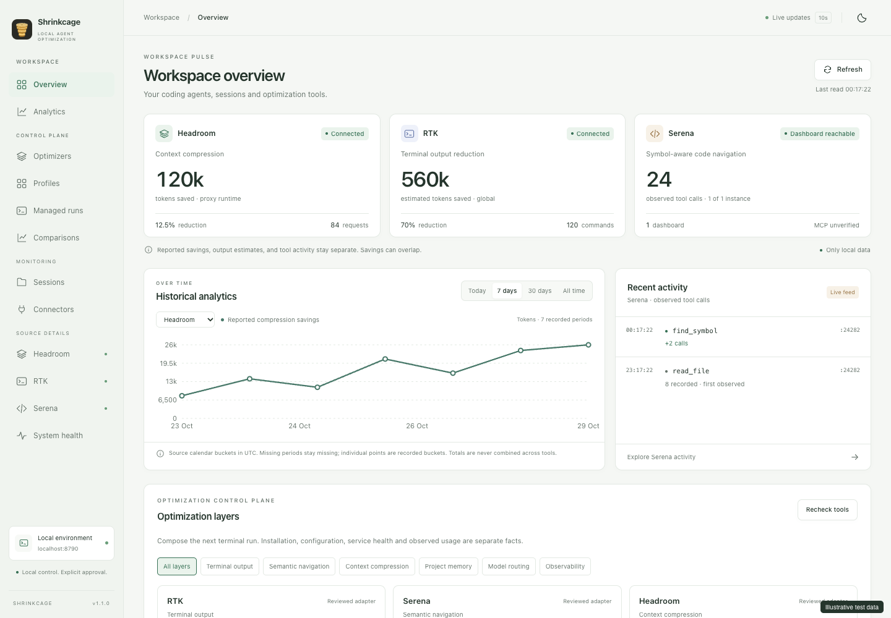
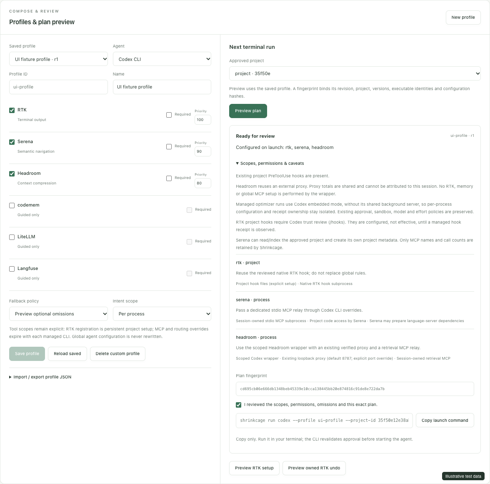
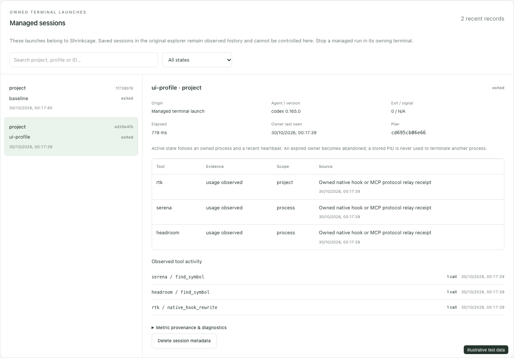

<p align="center"></p>

# Shrinkcage

**Local-first control plane for optimizing AI coding-agent CLI sessions.**

[](https://github.com/datasound-projects/Shrinkcage/actions/workflows/ci.yml)
[GitHub](https://github.com/datasound-projects/Shrinkcage) · [Issues](https://github.com/datasound-projects/Shrinkcage/issues) · [Control-plane guide](docs/CONTROL_PLANE.md)

See local agent history, understand optimizer contributions, compose a compatible profile, and launch Codex in your own terminal with an approved plan. One Node.js server serves the dashboard and API at **http://localhost:8790**. No Docker, cloud account, hosted telemetry or subscription is required by Shrinkcage. Agents and their model providers retain their own requirements.



Screenshots come from automated tests using synthetic sources. Production has no demo-data fallback. The animated golden coin mark respects reduced-motion preferences.

## Install and start

Install **Node.js 22.13+** and npm. Node 22.14 and 24 are the CI targets. Optional agents and optimizers are not installed automatically; missing tools never prevent dashboard startup.

```sh
git clone https://github.com/datasound-projects/Shrinkcage.git
cd Shrinkcage
```

| Platform | Start from the source directory |
|---|---|
| macOS / Linux | `./start.sh` |
| Windows PowerShell | `.\start.ps1` |
| Windows Command Prompt | `start.cmd` |
| Any supported platform | `node scripts/start.mjs` |

Startup checks the runtime, installs missing locked build dependencies, builds the app, binds **127.0.0.1:8790**, and opens your default browser. Keep the terminal open; Ctrl+C stops its owned server. Use `--no-open` or `OPEN_BROWSER=0` to suppress browser opening. If PowerShell restricts scripts, use the Node command without changing execution policy.

An existing Shrinkcage server is reused. Stop your old server before updating so new server code loads. An unrelated listener is never killed automatically.

### Install the built CLI

```sh
npm ci
npm run package
npm install --global ./release/shrinkcage-monitor-1.1.0.tgz
shrinkcage
```

The package contains the built frontend, compiled server and CLI, plus one small runtime TOML parser dependency. It needs no build tools after installation. Packaging also produces `release/SHA256SUMS`; verify it when transferring an archive. There is no npm-registry release implied by these instructions. Registry publication is guarded by `private: true`.

When using a source checkout without global installation, replace `shrinkcage` in commands below or copied from the dashboard with **`node bin/shrinkcage.mjs`**, after `npm run build`. Paths containing spaces must be quoted in your shell.

## Monitor, plan, run

The existing monitor remains available with no arguments, `shrinkcage ui`, and `shrinkcage --no-open`.

| Capability | What is actually supported |
|---|---|
| Observed agent history | Codex CLI, Claude Code and Gemini CLI: metadata, reported model/provider and usage, recorded tool names, sampling/coverage indicators |
| Shared optimization monitoring | Headroom proxy statistics/history; RTK output estimates/history; Serena dashboard instances, counters and observation log |
| Managed terminal runs | **Codex only**, through approved profiles; inherited input/output, working directory, signals and exit code |
| Managed RTK | Explicit project hook setup/undo; native `rtk hook codex` rewrite receipts; Codex hook trust still required |
| Managed Serena | Dedicated owned stdio MCP relay; successful handshake and tool-response evidence |
| Managed Headroom | Scoped wrapper reusing an existing healthy proxy, plus owned retrieval MCP; no proxy startup or global provider edits |
| Guided catalog | codemem, LiteLLM and Langfuse; no claimed activation, automatic installation, capture or export |

```sh
shrinkcage doctor
shrinkcage tools
shrinkcage plan codex --profile balanced --project .
shrinkcage run codex --profile balanced --project . -- --model YOUR_MODEL
```

`plan` registers the approved local project for the dashboard. Inspect omissions, warnings and scope before running. A terminal run prompts for the current plan fingerprint. Noninteractive use requires `--approve FULL_FINGERPRINT`; changed profiles, executable identities, configuration or discovery invalidate approval. Selecting a profile in the browser does not start an agent.

RTK setup is a separate, persistent project operation:

```sh
shrinkcage tool setup rtk --project . --dry-run
shrinkcage tool setup rtk --project . --approve FULL_FINGERPRINT
```

Review and trust the hook through Codex's own `/hooks` UI. Shrinkcage does not enable disabled hooks, bypass hook trust, weaken approvals or change your model/reasoning effort. Undo has its own preview and approval. [Full command reference and safety model](docs/CONTROL_PLANE.md).



Profiles include immutable **Baseline**, **Lean**, **Balanced** and **Memory** presets. Optional unavailable tools are explicitly omitted; mandatory tools or blocking fallback stop preflight. Managed optimizers use Codex's **embedded `--no-daemon` mode**, trading shared background-server operation for scoped configuration. This is disclosed in every relevant plan.

## Understand the evidence

Installed, configured, service healthy, agent connected, effective and usage observed are different facts. HTTP health is never treated as an MCP handshake. A run being active does not prove an optimizer was used. Managed session details show receipt provenance and actual tool names; prompts, arguments and outputs are not retained.

**Headroom and RTK savings may overlap and are never added.** Shared proxy/RTK totals remain shared even when sampled at the start/end of a managed run. MCP/hook receipts can correlate successful tool activity with a managed session; they do not establish token or dollar savings. Unknown is **N/A**, not zero. No model-price guesses are used.

Observed histories remain separate from managed sessions. File modification time means a file was updated recently, not that an agent is running. Serena's existing dashboard log timestamps are counter-observation times; grouped increases cannot recover exact execution order. Managed relay receipts likewise record response observation time.

The comparison view accepts completed Baseline and optimized runs, asks you to attest task/Git/model/effort equivalence and quality, and shows confounders. Elapsed time includes launcher, snapshots and teardown. It is not a causal savings benchmark.



## Local configuration and privacy

Default discovery reads Codex `~/.codex/sessions` and `archived_sessions` (or `CODEX_HOME`), Claude `~/.claude/projects` (or `CLAUDE_CONFIG_DIR`), and Gemini `~/.gemini/tmp` session JSON/JSONL. Connector center can approve another existing local history directory, disable a connector, and recheck discovery. Discovery does not install, authenticate or reconfigure any agent.

| Platform | App-data directory |
|---|---|
| macOS | `~/Library/Application Support/Shrinkcage` |
| Windows | `%APPDATA%\Shrinkcage` |
| Linux | `${XDG_CONFIG_HOME:-~/.config}/shrinkcage` |

`SHRINKCAGE_DATA_DIR` overrides app data. Legacy Shrinkage data directories and `SHRINKAGE_DATA_DIR` remain supported. Existing monitor settings and routes are preserved. The control plane adds its own versioned SQLite database, private project registry, setup journal/backups and bounded metadata. Backups may contain your original hook configuration: treat app data as private. No authentication files or environment dumps are sent to the browser.

Set optional variables in your shell; [.env.example](.env.example) is not auto-loaded. `SHRINKCAGE_HEADROOM_PORT` selects a fixed loopback port for managed Headroom (default 8787); the existing overview monitor continues to use its documented 8787 endpoint. `SERENA_PORT_START` / `SERENA_PORT_COUNT` configure dashboard discovery (default 24282–24291; max 20 ports).

Optimization monitoring refreshes every 10 seconds; observed/managed discovery every 15 seconds while visible. Requests coalesce and time out independently. Discovery samples large histories and labels coverage. Managed records default to 90-day retention and a 2,000-record ceiling; displayed/exported lists are bounded. See [Privacy and retention](docs/PRIVACY.md) before deleting app data or moving projects.

## Troubleshooting

- **Missing CLI:** start Shrinkcage from a terminal whose PATH contains the executable. Saved history can still be observed without it. Known Windows Node CLI shims are resolved without a shell; unusual wrappers need a supported executable entry point.
- **Blocked plan:** inspect `doctor`, `tool inspect TOOL` and plan diagnostics. Required tools, incompatible versions, unsafe config, duplicate hooks and unreviewed combinations fail closed. No installer is run by discovery.
- **RTK configured but no usage:** approve project hook trust in Codex, keep hooks enabled, then execute a command RTK actually rewrites. Configuration alone is not usage evidence.
- **Headroom offline or telemetry absent:** inspect `http://localhost:8787/health`. Start your own proxy; enable local metrics with `HEADROOM_TELEMETRY=on` on that proxy's launch command and restart it yourself. The native dashboard is `/dashboard`. Review Headroom's own privacy settings.
- **Serena reachable but inactive:** inspect Codex's MCP status and Serena startup logs. A separate dashboard instance may have no relationship to the managed run. Project indexing/language-server preparation can delay startup.
- **Setup interrupted or concurrently edited:** keep app-data backups. Preview setup again to recover an owned interrupted journal; preview undo for applied setup. Changed owned files produce conflicts rather than overwrites. Never remove an unknown lock just to make setup proceed.
- **Port occupied:** close your own old Shrinkcage instance; the launcher refuses an unrelated service. Process inspection can be incomplete due to permissions. HTTP health, listening status and integration evidence stay separate.
- **Node SQLite warning:** Node 22 may print its built-in experimental SQLite warning. It is not a connector failure.

## Development and releases

```sh
npm ci
npm test
npm run coverage
npm run build
node scripts/check-public.mjs
npm run package
npm run smoke
npx playwright install chromium
npm run test:ui
```

Tests use disposable synthetic sources; they never require model credentials or edit your live agent config. Cross-platform CI runs macOS/Linux/Windows × Node 22.14/24 and a Chromium browser job. [Validation evidence](docs/VALIDATION.md) distinguishes locally executed checks, hosted checks and native-integration limits. [Test matrix](docs/TEST_MATRIX.md) maps the release criteria to checks.

The release-artifact workflow builds a versioned archive and checksum as an Actions artifact; it does not publish a GitHub release or npm package. See [Contributing](CONTRIBUTING.md), [Security](SECURITY.md), [Connector compatibility](docs/CONNECTORS.md) and the [MIT license](LICENSE). Third-party terms are in [THIRD_PARTY_NOTICES.md](THIRD_PARTY_NOTICES.md).
